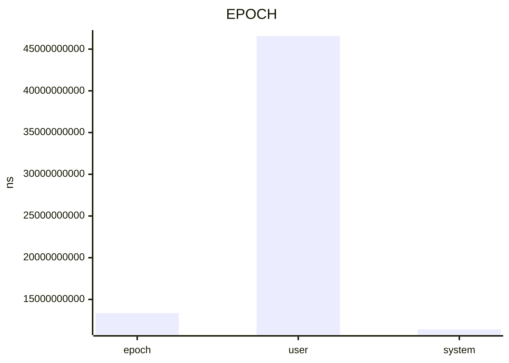

## epoch

+--------+-------+----------------------+-------------------+----------------------+----------------------+-------+------+------------------------------------------+
| key    | type  | value                | errorPercent      | min                  | max                  | calls | unit | samples                                  |
+========+=======+======================+===================+======================+======================+=======+======+==========================================+
| epoch  | float | 1.336025733333333e10 | 3.675777190618992 | 1.286916404166667e10 | 1.510215720833333e10 | 1     | ns   | 1.336025733333333e10, 1.286916404166667e |
|        |       |                      |                   |                      |                      |       |      | 10, 1.510215720833333e10                 |
+--------+-------+----------------------+-------------------+----------------------+----------------------+-------+------+------------------------------------------+
| user   | float | 4.6585702e10         | 1.012396464477449 | 4.6010459e10         | 4.7057334e10         | 1     | ns   | 4.6010459e10, 4.7057334e10, 4.6585702e10 |
+--------+-------+----------------------+-------------------+----------------------+----------------------+-------+------+------------------------------------------+
| system | float | 1.1405138e10         | 8.212158414917909 | 1.046853e10          | 1.3276794e10         | 1     | ns   | 1.1405138e10, 1.046853e10, 1.3276794e10  |
+--------+-------+----------------------+-------------------+----------------------+----------------------+-------+------+------------------------------------------+

