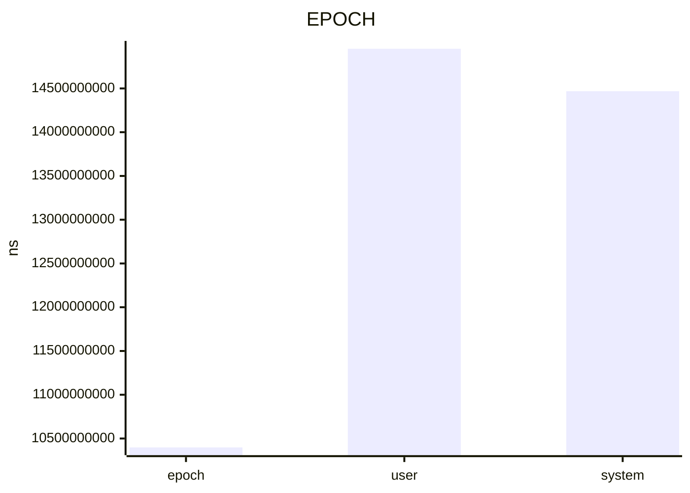

## epoch

+--------+-------+----------------------+--------------------+-----------------+----------------------+-------+------+------------------------------------------+----------------------+--------------------+---------------------+
| key    | type  | value                | errorPercent       | min             | max                  | calls | unit | samples                                  | baseline             | change             | probability         |
+========+=======+======================+====================+=================+======================+=======+======+==========================================+======================+====================+=====================+
| epoch  | float | 1.039836041666667e10 | 0.6534639976294279 | 1.0330410875e10 | 1.079420779166667e10 | 1     | ns   | 1.079420779166667e10, 1.0330410875e10, 1 | 1.336025733333333e10 | -22.16946008425186 | 0.5126907602619235  |
|        |       |                      |                    |                 |                      |       |      | .039836041666667e10                      |                      |                    |                     |
+--------+-------+----------------------+--------------------+-----------------+----------------------+-------+------+------------------------------------------+----------------------+--------------------+---------------------+
| user   | float | 1.4953633e10         | 3.027424840505314  | 1.4488659e10    | 1.5406343e10         | 1     | ns   | 1.4488659e10, 1.5406343e10, 1.4953633e10 | 4.6585702e10         | -67.90080999530714 | 0.04953461343562676 |
+--------+-------+----------------------+--------------------+-----------------+----------------------+-------+------+------------------------------------------+----------------------+--------------------+---------------------+
| system | float | 1.4468804e10         | 2.756551267126156  | 1.3625047e10    | 1.4867644e10         | 1     | ns   | 1.4867644e10, 1.4468804e10, 1.3625047e10 | 1.1405138e10         | 26.8621563369071   | 0.04953461343562676 |
+--------+-------+----------------------+--------------------+-----------------+----------------------+-------+------+------------------------------------------+----------------------+--------------------+---------------------+

