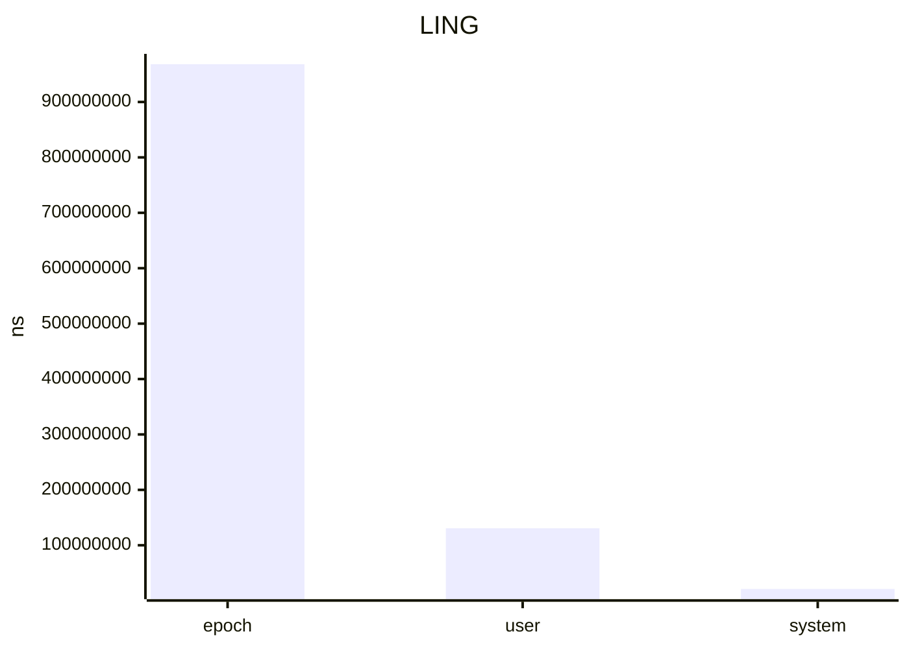
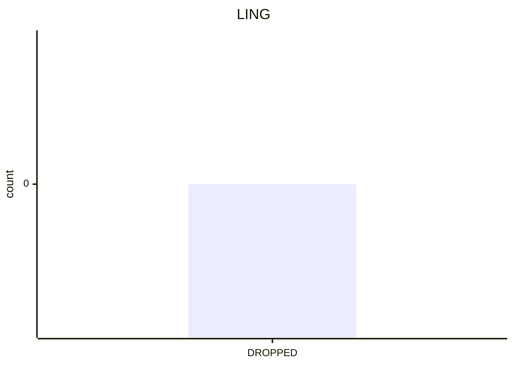

## ling

+---------+-------+--------------+--------------+--------------+--------------+-------+-------+--------------+
| key     | type  | value        | errorPercent | min          | max          | calls | unit  | samples      |
+=========+=======+==============+==============+==============+==============+=======+=======+==============+
| epoch   | float | 9.68257875e8 | 0.0          | 9.68257875e8 | 9.68257875e8 | 1     | ns    | 9.68257875e8 |
+---------+-------+--------------+--------------+--------------+--------------+-------+-------+--------------+
| dropped | float | 0.0          | 0.0          | 0.0          | 0.0          | 1     | count | 0            |
+---------+-------+--------------+--------------+--------------+--------------+-------+-------+--------------+
| user    | float | 1.30751e8    | 0.0          | 1.30751e8    | 1.30751e8    | 1     | ns    | 1.30751e8    |
+---------+-------+--------------+--------------+--------------+--------------+-------+-------+--------------+
| system  | float | 2.1127e7     | 0.0          | 2.1127e7     | 2.1127e7     | 1     | ns    | 2.1127e7     |
+---------+-------+--------------+--------------+--------------+--------------+-------+-------+--------------+

## run

+------------+--------+---------+
| key        | type   | value   |
+============+========+=========+
| build type | string | Release |
+------------+--------+---------+

