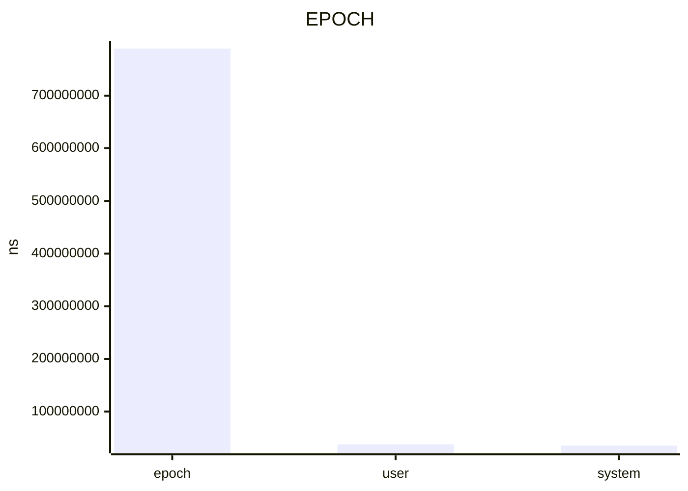

## epoch

+--------+-------+---------------------+--------------+---------------------+---------------------+-------+------+---------------------+
| key    | type  | value               | errorPercent | min                 | max                 | calls | unit | samples             |
+========+=======+=====================+==============+=====================+=====================+=======+======+=====================+
| epoch  | float | 7.894644166666666e8 | 0.0          | 7.894644166666666e8 | 7.894644166666666e8 | 1     | ns   | 7.894644166666666e8 |
+--------+-------+---------------------+--------------+---------------------+---------------------+-------+------+---------------------+
| user   | float | 3.7632e7            | 0.0          | 3.7632e7            | 3.7632e7            | 1     | ns   | 3.7632e7            |
+--------+-------+---------------------+--------------+---------------------+---------------------+-------+------+---------------------+
| system | float | 3.5437e7            | 0.0          | 3.5437e7            | 3.5437e7            | 1     | ns   | 3.5437e7            |
+--------+-------+---------------------+--------------+---------------------+---------------------+-------+------+---------------------+

